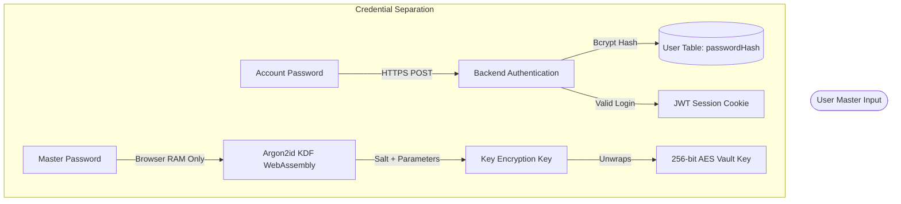
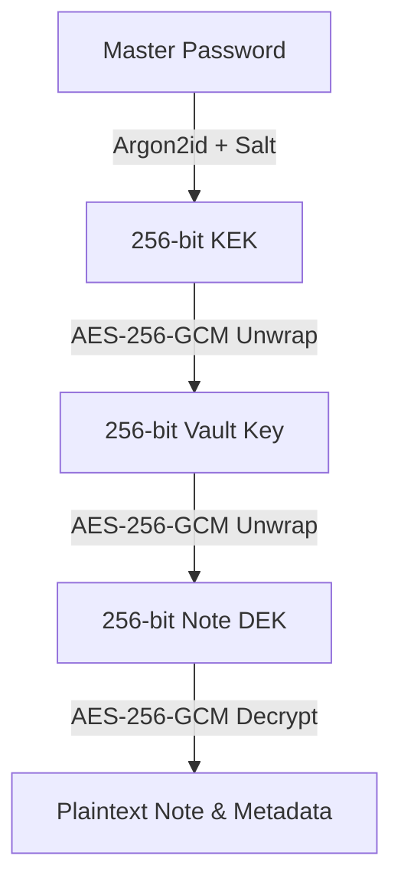

# ZEROLOCK System Architecture & Design

## 1. Architectural Philosophy

ZEROLOCK is designed around the core principle of **Zero-Knowledge Confidentiality**:
> The backend server, database administrators, and network intermediaries must have zero mathematical capability to decrypt user notes, inspect note titles, or derive cryptographic keys.

To achieve this without compromising rich user experience (e.g. rich text formatting, full-text search, attachments, and password changes), ZEROLOCK implements **Client-Side Envelope Encryption** partitioned by a dual-credential boundary.

---

## 2. Dual-Credential Model

ZEROLOCK enforces two strictly separated credentials for every user account:

### Key Differences:
1. **Account Password**:
   - Sent to backend over TLS.
   - Hashed using salted `bcrypt` with cost factor 12.
   - Solely used to authenticate HTTP requests and issue session JWTs.
   - Modifying this password has zero impact on note ciphertexts.
2. **Master Password**:
   - **NEVER** transmitted over the network under any circumstance.
   - Processed in local browser RAM using WebAssembly Argon2id.
   - Derives the 256-bit Key Encryption Key (KEK) used to unwrap the Master Vault Key.

---

## 3. Four-Tiered Envelope Encryption Architecture

### Tier Specification:
- **Tier 1 (Master Password)**: Memorized secret.
- **Tier 2 (Key Encryption Key / KEK)**: Ephemeral 256-bit key derived deterministically using Argon2id.
- **Tier 3 (Vault Key)**: Cryptographically secure 256-bit random key generated during account registration (`crypto.getRandomValues()`). Unwraps all per-object DEKs.
- **Tier 4 (Data Encryption Keys / DEKs)**: Ephemeral 256-bit random keys generated fresh for each individual note and attachment.

---

## 4. Request & Cryptographic Lifecycle

### Note Creation & Storage Flow:
1. User writes content in TipTap rich text editor.
2. Browser generates unique 256-bit Note DEK via WebCrypto API.
3. Content is encrypted using AES-256-GCM with a fresh 96-bit nonce.
4. Metadata (`{ title, tags, category }`) is encrypted using AES-256-GCM with a separate fresh 96-bit nonce.
5. Note DEK is wrapped using the Vault Key with a third 96-bit nonce.
6. The browser transmits the bundle of base64 ciphertexts and nonces to `POST /api/notes`.
7. The backend verifies the session JWT, validates the payload with Zod, and persists the record to MongoDB.

### Note Retrieval & Decryption Flow:
1. Client requests `GET /api/notes`.
2. Backend checks record ownership: `{ userId: req.user.id }`.
3. Backend returns list of encrypted documents.
4. Client unwraps Note DEK using in-memory Vault Key.
5. Client decrypts metadata and content.
6. Client updates local volatile search index in RAM.

---

## 5. Technology Stack Summary

- **Frontend**: React 18, TypeScript, Vite, Tailwind CSS, TipTap Editor, Framer Motion, Lucide Icons, TanStack React Query.
- **Backend**: Node.js, Express.js, TypeScript, Mongoose, Helmet, Cookie-Parser, Multer, Zod.
- **Cryptography**: Native W3C Web Cryptography API (`window.crypto.subtle`), `hash-wasm` (Argon2id WebAssembly implementation).
- **Database**: MongoDB v6+ with automated `mongodb-memory-server` development fallback.
