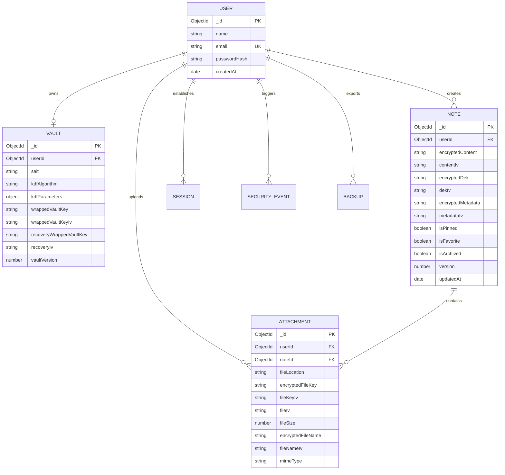

# ZEROLOCK Database Design & Schemas

## 1. Zero-Knowledge Database Philosophy

The ZEROLOCK database schema is explicitly designed so that:
1. No plaintext note content, title, tags, or file names are stored.
2. No master passwords or raw encryption keys are stored.
3. Every read and mutation is scoped by compound index to the authenticated user ID (`userId`).

---

## 2. Entity Relationship Diagram

---

## 3. Database Indexing Strategy

1. `users.email`: Unique index for $O(1)$ email lookup during authentication.
2. `vaults.userId`: Unique index ensuring exactly one cryptographic vault per user.
3. `notes.{ userId: 1, updatedAt: -1 }`: Compound index optimizing sorting and retrieval of user notes.
4. `sessions.{ expiresAt: 1 }`: MongoDB TTL index for automated background cleanup of expired sessions.
5. `security_events.{ userId: 1, createdAt: -1 }`: Compound index for rapid pagination of audit logs.
